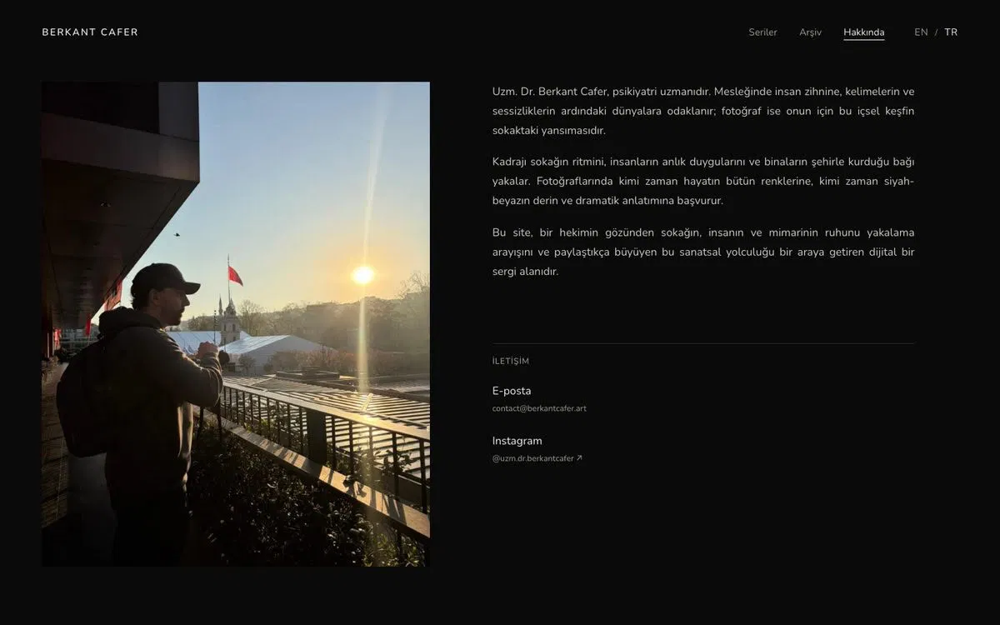

# berkantcafer.art

A bilingual photography portfolio for Berkant Cafer.

**Live site:** https://berkantcafer.art

## About the project

Berkant Cafer photographs street scenes, people, faces, urban detail and sculpture, in black and white and in colour. The design is minimal and dark, so the focus stays on the photographs.

## What's on the site

- **Series:** curated sets of photographs
- **Archive:** the wider collection
- **About:** the photographer
- Every page in English and Turkish

## Screenshots

## How it was built

I built the site together with a computer engineer friend. We worked out the structure and design together, built it with the help of Claude, and tested it end to end before launch.

## Notes

The source code is private. This repository documents the project.
